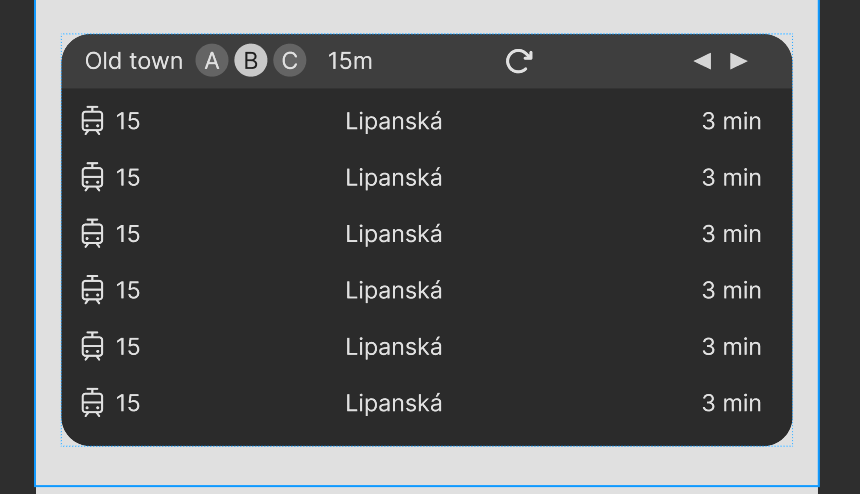

# Prague Transit Arrivals

An Android home screen widget built with Jetpack Glance that serves as an automatic, live departure board for Prague public transit (PID – Pražská integrovaná doprava).

It detects your nearest transit stop, identifies individual platforms, and provides real-time departure countdowns with live vehicle delays—all at a glance without having to unlock your phone and launch a full transit application.



---

## Key Features

- **Automatic Proximity Detection**: Resolves the user's nearest transit Stop via GPS using an adaptive search radius (100 m expanding up to 500 m).
- **Platform-Level Precision**: Differentiates between physical boarding poles/platforms (*označníky*), automatically selects the closest platform to the user, and enables single-tap switching between directions or tracks.
- **Live Countdown & Delay Tracking**: Displays relative countdown minutes (`<1 min`, `3 min`, etc.) and delay indicators (`+2 min`) powered directly by Prague's official Golemio Open Data API. Departures more than 30 minutes out transition cleanly to timetable clock time (`16:45`).
- **Multi-Modal Transit Support**: Clear visual indicators for Metro, Tram, Bus, Trolleybus, and Train lines with destination headsigns (*Terminus*).
- **Stop & Platform Navigation**: Cycle through nearby transit stops using header navigation controls (`◀` / `▶`) or open full scrollable Stop and Platform picker views with walking distance badges.
- **Scrollable Departure Board**: View upcoming departures directly in the widget with responsive layout sizing across different home screen dimensions.
- **Underground & Offline Resilience**:
  - **Metro Fallback**: Accepts cached GPS fixes up to 30 minutes old when descending into underground metro stations where GPS signal is lost.
  - **Offline Caching**: Displays the last retrieved departures with an amber warning banner (*"Cached 15:42 • Tap to retry"*) during network dropouts or rate limits.
- **Companion Settings & Simulation Activity**:
  - Securely store and test your Golemio API token.
  - Test GPS fixes and preview nearby stops.
  - Built-in stop simulators for Prague transit hubs (e.g., *I. P. Pavlova*, *Anděl*, *Muzeum*, *Hlavní nádraží*) for easy emulator testing without GPS spoofing.
- **Bilingual Interface**: Full English and Czech system locale support while preserving authentic Prague stop names.

---

## Domain Terminology

This project strictly adheres to the domain model documented in [GLOSSARY.md](GLOSSARY.md):

| Term | Definition |
| :--- | :--- |
| **Stop** | A named public transit hub or station comprising one or more physical Platforms (e.g., *I. P. Pavlova*, *Anděl*). |
| **Platform** | A specific physical boarding pole, track, or quay within a Stop (e.g., *Platform A*, *Platform B*). |
| **Departure** | A scheduled or real-time transit vehicle leaving a Platform toward a given Terminus. |
| **Delay** | Difference in minutes between scheduled departure and predicted real-time departure. |
| **Line** | Public transit route identifier (e.g., *Tram 22*, *Metro A*, *Bus 119*). |
| **Terminus** | The final destination text displayed on the vehicle indicating travel direction. |
| **Transport Mode** | Vehicle category: *Metro*, *Tram*, *Bus*, *Trolleybus*, or *Train*. |

---

## Tech Stack & Architecture

- **Language & Runtime**: Kotlin 2.0 targeting JVM 17.
- **Widget Framework**: [Jetpack Glance](https://developer.android.com/jetpack/compose/glance) (`androidx.glance:glance-appwidget:1.1.1`).
- **UI & Architecture**: Jetpack Compose, Material 3, AndroidX lifecycle & coroutines.
- **Background Refreshing**: Android WorkManager with periodic syncing and on-demand tap updates.
- **Data Source**: Direct client integration with [Prague Golemio Open Data API](https://api.golemio.cz/) (`v2/departureboards`), bypassing custom backend proxies ([ADR 0001](docs/adr/0001-direct-golemio-client.md)).
- **Location Engine**: Google Play Services `FusedLocationProviderClient` with last-known fallback ([ADR 0003](docs/adr/0003-last-known-location-fallback.md)).
- **Compatibility**: Minimum SDK 26 (Android 8.0) up to Target SDK 35 (Android 15).

---

## Getting Started

### Prerequisites

- Android Studio Ladybug (2024.2.1) or newer
- JDK 17
- Android SDK 35
- A free Golemio API key:
  1. Register at [api.golemio.cz](https://api.golemio.cz/).
  2. Generate a free API token (`X-Access-Token`).

### Build & Install

1. **Clone the repository:**
   ```bash
   git clone https://github.com/RiegelZdenek/arrivals.git
   cd arrivals
   ```

2. **Assemble the debug APK:**
   ```bash
   ./gradlew assembleDebug
   ```

3. **Run Unit Tests:**
   ```bash
   ./gradlew test
   ```

4. **Install to a connected device or emulator:**
   ```bash
   ./gradlew installDebug
   ```

### Setup on Device

1. Open the **Arrivals Settings** app on your device.
2. Enter your **Golemio API Token** and tap **Test Connection** to verify access.
3. Long-press your home screen, select **Widgets**, and add **Prague Transit Arrivals**.
4. Grant location permissions when prompted to let the widget detect your nearest stop.
5. (Optional) If running on an emulator without GPS, use the **Prague Stop Simulation** section in the settings app to preview departures for any major Prague hub.

---

## Project Structure

```
arrivals/
├── app/
│   ├── src/main/java/cz/riegel/arrivals/
│   │   ├── api/            # Direct Golemio REST client and DTOs
│   │   ├── data/           # Repositories, Stop registry & caching
│   │   ├── engine/         # ArrivalsEngine state reducer & domain models
│   │   ├── location/       # FusedLocation provider & stale fix fallback
│   │   ├── ui/             # SettingsActivity and configuration UI
│   │   ├── widget/         # Jetpack Glance widget, pickers & action receivers
│   │   └── worker/         # WorkManager background sync workers
│   └── src/test/           # Unit & integration tests (JUnit, Robolectric)
├── docs/                   # Architectural Decision Records (ADR) & agent guidelines
├── GLOSSARY.md             # Canonical project terminology
└── SPEC.md                 # Product specifications and user stories
```

---

## Testing

Run unit tests via Gradle:

```bash
./gradlew testDebugUnitTest
```

The test suite covers:
- Core state reduction and relative countdown calculations in `ArrivalsEngineTest`.
- Proximity stop detection, platform grouping, and caching resilience.
- Golemio REST API serialization and error recovery contracts.
- Widget picker navigation, item IDs, and action callbacks.

---

## Documentation & Decisions

- [GLOSSARY.md](GLOSSARY.md) - Domain language rules and prohibited terms.
- [SPEC.md](SPEC.md) - Detailed product specifications, user stories, and acceptance criteria.
- [ADR 0001: Direct Golemio API Integration](docs/adr/0001-direct-golemio-client.md)
- [ADR 0002: Jetpack Glance App Widget](docs/adr/0002-jetpack-glance-ui.md)
- [ADR 0003: Last-Known Location Fallback](docs/adr/0003-last-known-location-fallback.md)
